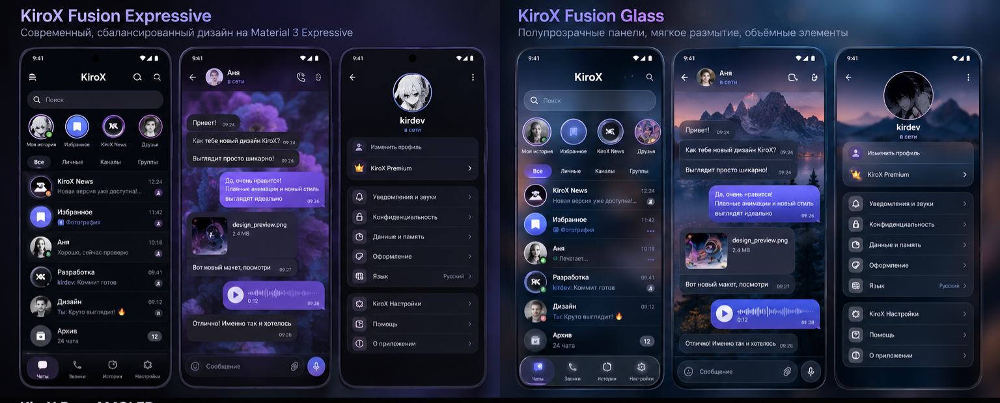

# ЭТАЛОН №1 — KiroX Fusion Expressive + Fusion Glass (точный макет владельца)

**Статус:** APPROVED ORIGINAL — пользователь отдельно подтвердил 29 октября 2026, что понравились **оба стиля целиком: цвета, расположение, пропорции, фоны, навигация и композиция экранов**.

## Идентификация единственного правильного оригинала

- Заголовки оригинального изображения: \`KiroX Fusion Expressive\` (слева) и \`KiroX Fusion Glass\` (справа).
- Оригинальное разрешение: **1536 × 620**, формат **PNG**.
- SHA-256 оригинального файла: \`009265773e852eac2d944835d0fcbde1818da2a7296f751297065bfb23d2d4f3\`.
- Исходное имя файла владельца в беседе: \`1000084555.png\`.
- Предназначенный путь в репозитории: \`design-reference/fusion-v2/assets/KiroX_Fusion_Expressive_Glass_APPROVED_ORIGINAL.png\`.
- **Важно:** оригинальные бинарные байты пользовательского PNG доступны в текущем чате, но пока НЕ зафиксированы в GitHub — этот документ и старый \`preview.html\` НЕ заменяют изображение. До получения именно этого файла у Claude Code нет достаточных данных для проверки pixel-perfect. Если файл присутствует позже — проверить SHA-256.
- Ни \`design-reference/KIROX_MAIN_SCREENS.png\` (старый прототип), ни \`preview.html\`, ни новый сгенерированный концепт **НЕ ЯВЛЯЮТСЯ ИМЕННО ЭТИМ ИЗОБРАЖЕНИЕМ**.

## Структура шести экранов в оригинале (НЕ менять)

| Позиция | Тема | Экран | Принцип размещения |
|---|---|---|---|
| 1, левый | Fusion Expressive | Главный экран чатов | KiroX по центру шапки; слева меню; справа поиск и действие; большой округлый поиск ниже; затем **ряд круглых историй**, отдельные фильтры-чипы, плотный список чатов с аватарами, временем и статусами; внизу Чаты/Звонки/Истории/Настройки и **подсвеченная активная пилюля** |
| 2 | Fusion Expressive | Переписка | Шапка с аватаром/именем/«в сети», действия справа; фиолетовый цветочно-абстрактный фон **на всю рабочую поверхность**; входящие тёмные полупрозрачные; исходящие насыщенно-сиреневые; медиа-карточка и сиреневый голосовой; внизу округлое поле с отправкой голосового |
| 3 | Fusion Expressive | Профиль / настройки | Чёрная глубокая основа, большой круглый аватар по центру, имя и статус; ниже **две компактные группы** кнопок-карточек; вверху группа «Изменить профиль», Premium (реальный статус Telegram, не ложный бренд), ниже настройки уведомлений, приватности, данных, оформления, языка, KiroX и помощь |
| 4 | Fusion Glass | Главный экран чатов | **То же расположение**, но сине-графитовый стеклянный поиск, прозрачные списки с тонким разделением, синие круглые рамки историй, сине-фиолетовые активные фильтры и **плавающий стеклянный нижний док** |
| 5 | Fusion Glass | Переписка | **Те же шапка, сообщения, медиа и composer**, однако позади них виден **реальный тематический фон гор/озера с вечерним небом**, мягкий голубой градиент-подложка для контраста; пузыри стеклянные, исходящие сине-сиреневые; обводки и мягкое свечение |
| 6, правый | Fusion Glass | Профиль / настройки | Аватар над стеклянными карточками; верхний фон гор с лёгкой дымкой, затем тёмный navy; группы полупрозрачных округлых пунктов с тонкой голубой обводкой; **расположение пунктов совпадает с Expressive** |

## Очень важные визуальные подробности, которые отсутствуют в текущей реализации

1. **Expressive — не просто сиреневый primaryColor + сплошной фиолетовый градиент.** В утверждённом макете есть настоящая иерархия поверхностей, фактурный фон переписки, контрастные карточки, объёмные иконки, разные уровни освещения и округления.
2. **Glass — не та же Expressive с синим tint.** Действительно другой метод отрисовки: тематическая картинка за контентом (с правами на использование!), полупрозрачные слои поверх неё, локальный blur там, где безопасно, тонкие strokes/свечение и непрозрачный fallback.
3. **Шапка чатов:** центральный KiroX и функциональная полоса поиска — не один большой стандартный Material TopAppBar.
4. **Строка Stories сразу под поиском**; отдельные фильтры \`Все / Личные / Каналы / Группы\` ниже; затем именно список диалогов, без декоративного грид-каталога.
5. **Профиль:** компактный круглый аватар + статус сверху, функциональные карточки группами ниже. Не превращать его в длинный плоский список или отдельную копию настроек без шапки.
6. **Переписка:** красивые пропорции пузырей, отдельные контрастные вложения и компактная голосовая карточка с волной; сообщения не потеряны на фоне рисунка.
7. **Нижняя навигация:** \`Чаты · Звонки · Истории · Настройки\`, pill indicator подсвечивает только активную вкладку. Контакты и личный профиль остаются доступными из дополнительных маршрутов.
8. Не рисовать фиктивные Premium/verified/status. Имена, фото и сообщения из макета — демонстрационный дизайн, не источники данных TDLib.

## Пиксельная геометрия из original 1536×620

Это исходный collage, а не размеры Android dp. Нормированные области на листе:

| Область | Примерные координаты x/y/ширина/высота |
|---|---|
| Левая тема / заголовок | x≈30–745, y≈12–63 |
| Expressive — Чаты | x≈30–264, y≈73–599 |
| Expressive — Переписка | x≈273–507, y≈73–599 |
| Expressive — Профиль | x≈519–748, y≈73–599 |
| Правая тема / заголовок | x≈795–1510, y≈12–63 |
| Glass — Чаты | x≈791–1024, y≈73–599 |
| Glass — Переписка | x≈1031–1275, y≈73–599 |
| Glass — Профиль | x≈1283–1513, y≈73–599 |

Эти координаты нужны для точного сопоставления композиции, **не** для хардкода Android размеров. В репозитории лежит **полный исходный PNG 1536×620**. Не использовать предыдущий сгенерированный вариант вместо него.

## Обязательный процесс для Claude Code

1. **Остановить дальнейшие правки Compose** до сверки current screenshots с точным оригиналом и одобрения исправления.
2. Получить оригинал с указанным SHA. Если этот путь ещё отсутствует — написать \`MISSING_APPROVED_PNG\`, не заявлять, что все 92 экрана получили visual-pass.
3. Сделать шестистрочную матрицу \`Экран | Макет | Реальная реализация | Отличия | Файлы к изменению\`.
4. Выделить P0 различия: реальные фоны вместо однотонных градиентов, прозрачность Glass, геометрия поиска/историй/нижнего дока, шапки и компактные секции настроек, композиция wallpaper и media, типографика.
5. Не делать тотальный rewrite, не заменять настоящие TDLib данные моками, не ломать VoIP, авторизацию и multi-account.
6. Показывать новые screenshots после **одного маленького подэтапа** и ожидать обратной связи владельца; не продолжать автоматически по 92 макетам.

## Версия и производительность

\`MainActivity.kt\` в коммите \`e3d01c3\` глобально обнуляет motion через \`KiroXFeatures.ANIMATIONS\`. Это нельзя считать эквивалентом утверждённого плавного Fusion: вернуть контролируемые анимации с Reduce Motion/Power Saver/низкопроизводительным fallback, измерять jank/FPS на реальном железе.

**Авторитет эталонов:** точное пользовательское PNG → явно утверждённые варианты других экранов → текстовые спецификации → упрощённый browser preview. Новые AI-варианты не могут переопределить более ранний утверждённый макет.
